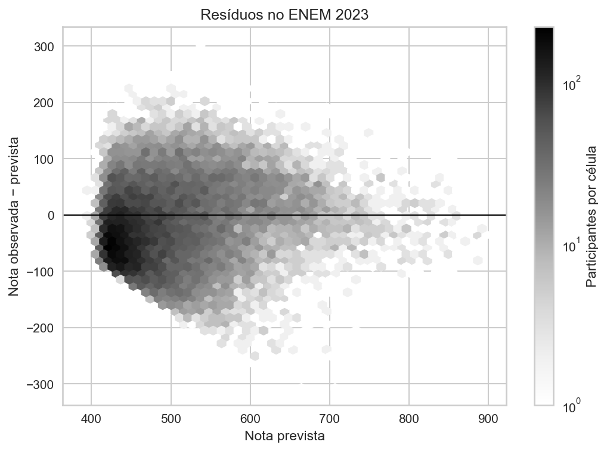
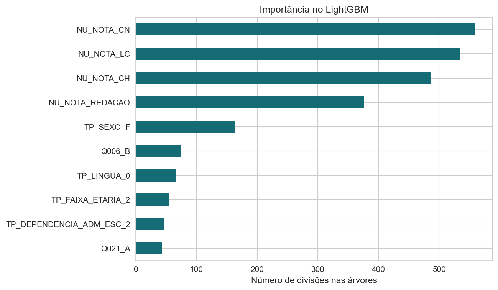

# Previsão da nota de Matemática no ENEM | Maranhão

Na minha pós-graduação em Data Science & Analytics na USP/Esalq, desenvolvi o TCC *Utilização de variáveis socioeducacionais e de desempenho para predição de nota ENEM em Matemática*, que assino com Ricardo Limongi (2025). Usei os microdados do ENEM para estimar a nota de Matemática de concluintes de escolas maranhenses a partir do perfil socioeducacional e das notas de Redação, Ciências Humanas, Ciências da Natureza e Linguagens. Por isso, só consigo estimar a nota de Matemática depois de conhecer as outras quatro notas.

Quando avaliei o LightGBM com os dados de 2023, obtive **R² de 0,5716** e **erro absoluto médio de 60,5687 pontos**. Redação, Ciências Humanas e Ciências da Natureza aparecem nas três primeiras posições da Figura 4. A importância expressa o uso das variáveis pelo modelo e não permite inferir efeitos causais.

## Resultados do estudo

| LightGBM | MAE (pontos) | MSE (pontos²) | RMSE (pontos) | R² |
|---|---:|---:|---:|---:|
| Validação cruzada, Tabela 4 | 60,052 | 5.607,637 | 74,872 | 0,5704 |
| Teste em 2023, Tabela 5 | 60,5687 | 5.512,3582 | 74,2453 | 0,5716 |

Transcrevi as duas tabelas e os resultados dos cinco modelos que comparei no [CSV do TCC](resultados/tcc.csv). Há aparentes deslocamentos de casa decimal na Tabela 4. Para Random Forest, a apresentação informa RMSE de 77,7922. Para regressão linear, informa MAE de 62,033 e RMSE de 77,4078. Os valores acima para LightGBM vêm das tabelas do trabalho escrito.

## Reprodução com os microdados

| LightGBM no teste de 2023 | TCC | Reprodução | Diferença (reprodução − TCC) |
|---|---:|---:|---:|
| MAE (pontos) | 60,5687 | 60,2090 | −0,3597 |
| MSE (pontos²) | 5.512,3582 | 5.450,5800 | −61,7782 |
| RMSE (pontos) | 74,2453 | 73,8280 | −0,4173 |
| R² | 0,5716 | 0,5764 | +0,0048 |

Ao reproduzir o teste de 2023, obtive um erro absoluto médio a menos de meio ponto do valor que encontrei no TCC. Na validação cruzada de 2022, a diferença foi maior. O Gradient Boosting liderou por R² (0,5165), seguido do LightGBM (0,5132). No TCC, o LightGBM liderou com 0,5704. Para comparar os resultados com os da Tabela 5, avaliei o LightGBM no teste de 2023. As quatro notas das outras provas também lideraram a importância na reprodução, na ordem Ciências da Natureza, Linguagens, Ciências Humanas e Redação.

[Comparação dos cinco modelos](resultados/reproducao/validacao_cruzada.csv) · [Dez dobras do LightGBM](resultados/reproducao/folds_lightgbm.csv) · [Teste de 2023](resultados/reproducao/teste_2023.csv)





## Metodologia implementada

1. Li os microdados em blocos e apliquei os critérios `SG_UF_ESC = MA`, `TP_ENSINO = 1` (regular), `TP_ST_CONCLUSAO = 2` (conclusão no ano), `IN_TREINEIRO = 0` e `NU_NOTA_MT > 0`. Excluí registros com valores ausentes nas colunas da análise. A UF identifica a escola do participante.
2. Construí indicadores por categoria para o perfil do participante, da escola e para as respostas de Q001 a Q025. Q005, o número de moradores, entra como contagem. As letras das respostas identificam as categorias do dicionário de cada edição. Os códigos geográficos, identificadores, respostas às provas, gabaritos, presenças e notas por competência da redação ficam fora dos preditores.
3. Selecionei variáveis por regressão linear stepwise com intercepto. A cada rodada entra o preditor com o menor p-valor abaixo de 0,05. Após a inclusão, saem as variáveis com p-valor maior ou igual a 0,05. O algoritmo ignora candidatas constantes ou linearmente dependentes das já selecionadas.
4. Usei a edição de 2022 para treinar e comparar LightGBM, Gradient Boosting, XGBoost, Random Forest e regressão linear em dez dobras com PyCaret. O pré-processamento usa remoção de multicolinearidade com limite de 0,95, normalização min-max, alvo em pontos e nenhuma imputação.
5. Ajustei o LightGBM em 2022, avaliei as previsões em 2023 e salvei o pipeline. Os gráficos mostram os resíduos em pontos e a importância pelo número de divisões nas árvores.

**Decisões de reconstrução.** No TCC, registrei os anos de treino e teste. Deixei em aberto a edição usada no stepwise, a semente ou a lista completa de candidatas que originou as 162 colunas descritas. Nesta reprodução, escolhi 2021 para selecionar as variáveis e para preservar a independência da validação de 2022 e do teste de 2023. Fixei a semente em 42. A lista de candidatas está em [preparar.py](preparar.py). As categorias da Tabela 2 servem como referência histórica e a seleção executada fica registrada em [selecao.csv](resultados/reproducao/selecao.csv).

### Amostra e seleção da reprodução

| Edição | Inscritos no arquivo | Participantes elegíveis | Uso |
|---|---:|---:|---|
| 2021 | 3.389.832 | 16.144 | Seleção de variáveis |
| 2022 | 3.476.105 | 20.114 | Treino e validação cruzada |
| 2023 | 3.933.955 | 22.829 | Teste temporal |

Ao codificar os dados de 2021, obtive 173 preditores candidatos. Selecionei 43 pelo método stepwise. Em uma conferência independente por mínimos quadrados ordinários, o maior p-valor entre os preditores retidos foi 0,03593. Entre os candidatos restantes linearmente independentes do modelo, o menor p-valor de entrada foi 0,05745.

## Executar

Use Python 3.11. Na pasta `dados`, coloque os ZIPs anuais do Inep com o nome `microdados_enem_AAAA.zip`, ou os CSVs nacionais `MICRODADOS_ENEM_AAAA.csv` de 2021 a 2023. O leitor aceita os ZIPs diretamente. [Catálogo oficial do Inep](https://www.gov.br/inep/pt-br/acesso-a-informacao/dados-abertos/microdados/enem)

```bash
python -m venv .venv
# Windows PowerShell
.venv/Scripts/Activate.ps1
# Linux ou macOS: source .venv/bin/activate
python -m pip install -r requirements.txt
python experimento.py --dados dados --saida resultados/minha_execucao
```

O diretório de saída recebe as contagens por edição, as variáveis selecionadas, as métricas de validação e teste, os gráficos e o arquivo local `modelo_gbm.pkl`. O modelo salvo recebe as colunas codificadas de `selecao.csv`; os nomes e a ordem devem corresponder aos do treino.

### Origem dos arquivos da reprodução

Para reproduzir a análise, usei as cópias públicas dos microdados do Inep listadas abaixo. Os hashes SHA-256 identificam os arquivos utilizados.

| Edição | Arquivo | SHA-256 |
|---|---|---|
| 2021 | [ZIP no Kaggle](https://www.kaggle.com/datasets/yarleicavalcante/microdados-enem-2021) | `f72640a077b2ece51f460038ca65e8c24c1479b60b8944060351757c84ca0bc1` |
| 2022 | [CSV no Hugging Face](https://huggingface.co/datasets/Luc4s-Carv/educadados-token/blob/main/MICRODADOS_ENEM_2022.csv) | `37df472a1f9b791eef4ebcdbb42dd75cc0bdbc09efba7ec724892c3b257c5d28` |
| 2023 | [CSV no Hugging Face](https://huggingface.co/datasets/Luc4s-Carv/educadados-token/blob/main/MICRODADOS_ENEM_2023.csv) | `c8b1fae0a97b6ac826d950d16696efa3d89c133b0165128aadd2997c2315b666` |
